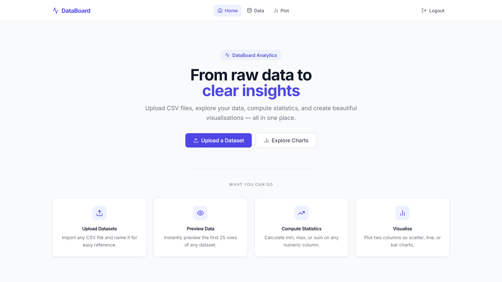
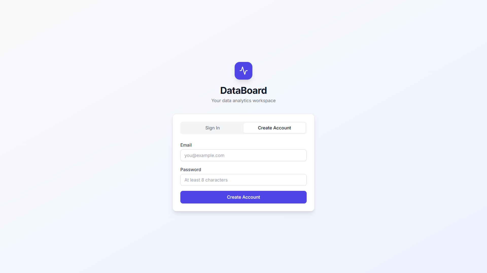
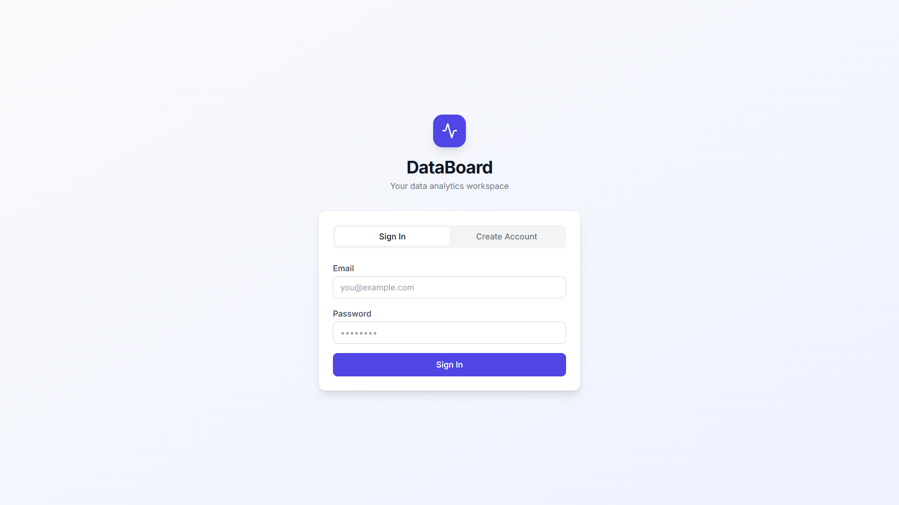
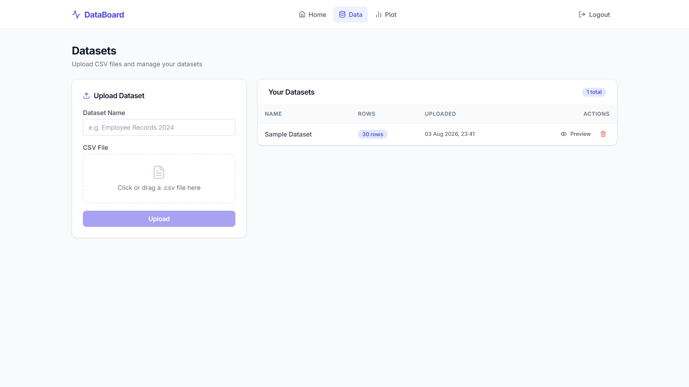
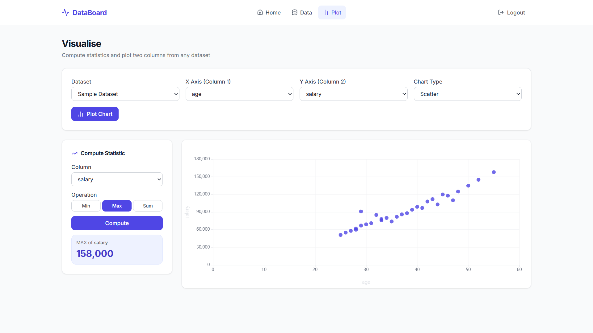

# DataBoard — Setup & Deployment Guide

---

## User Interface

- Home
 
  

- Register
 
  

- Login
 
  

- Data

  

- Plot

  

---

## Architecture

```
Browser (Angular)
    │
    ├── HTTPS → CloudFront (d2bnceyxxb14a6) → S3 (databoard-frontend-kritansh)
    │
    └── HTTPS → CloudFront (d1e2ji77wggvgr) → EC2 t3.micro :8000
                                                  FastAPI + uvicorn + systemd
                                                        │
                                                        │ SQLAlchemy + psycopg2
                                                        ▼
                                                   PostgreSQL
                                                   AWS RDS db.t4g.micro
```

---

## Tech Stack

**Backend:** Python 3.14 · FastAPI · Uvicorn · SQLAlchemy · PostgreSQL (psycopg2) · Pydantic · JWT (python-jose) · passlib/bcrypt · pandas · pytest

**Frontend:** Angular 21 · TypeScript · Tailwind CSS · ECharts (ngx-echarts) · RxJS · Node.js 24

**Infrastructure:** AWS EC2 (t3.micro, Ubuntu 26.04) · AWS RDS PostgreSQL (db.t4g.micro) · AWS S3 · AWS CloudFront (×2 — frontend + backend)


---

## Prerequisites

| Tool | Required Version | Install |
|---|---|---|
| Python | ≥ 3.11 | python.org |
| Node.js | 24.10.0 (≥ 18) | nodejs.org |
| Angular CLI | ≥ 21 | `npm install -g @angular/cli@21` |
| AWS CLI | any | aws.amazon.com/cli |
| AWS Account | Free tier | aws.amazon.com |

---

## 1. Database — AWS RDS PostgreSQL

### Create RDS Instance
1. AWS Console → **RDS** → **Create database**
2. Engine: **PostgreSQL** · Template: **Free tier**
3. DB identifier: `databoard-db`
4. Master username: `dbadmin` · Set a strong password
5. Initial database name: `databoard`
6. **Publicly accessible: Yes**
7. Click **Create** (takes ~5 min)

### Open Port 5432
- Go to RDS instance → **Connectivity & security** → click the VPC security group
- **Inbound rules** → **Edit** → Add rule:
  - Type: `PostgreSQL` · Port: `5432` · Source: `0.0.0.0/0`

### Get Connection String
```
postgresql://dbadmin:<password>@<your-endpoint>.rds.amazonaws.com:5432/databoard
```
> ⚠️ Use `databoard` (not `postgres`) — this is the **Initial database name** set during RDS creation.

**Project RDS endpoint:**
```
databoard-db.cixyeakci7ph.us-east-1.rds.amazonaws.com
```

---

## 2. Backend — Local Development

```powershell
cd k:\Web-apps\xVector\backend

# Create and activate virtual environment
python -m venv venv
.\venv\Scripts\activate

# Install dependencies
pip install -r requirements.txt

# Create .env from template
copy .env.example .env
# Edit .env — paste your RDS connection string and a random SECRET_KEY

# Start the API server (tables are auto-created on startup)
uvicorn app.main:app --reload
```

- API runs at: **http://localhost:8000**
- Auto-docs: **http://localhost:8000/docs**

### Generate a SECRET_KEY
```powershell
python -c "import secrets; print(secrets.token_hex(32))"
```
> Copy the output into `SECRET_KEY=` in `.env`. Do **not** use this value as a login password.

### bcrypt compatibility note
`requirements.txt` pins `bcrypt==4.0.1` explicitly alongside `passlib[bcrypt]==1.7.4`.
Newer bcrypt (5.x) removes `__about__` which breaks passlib — the pin prevents this.

> ⚠️ User account passwords must be **< 72 characters** (bcrypt hard limit).

---

## 3. Frontend — Local Development

```powershell
cd k:\Web-apps\xVector\frontend

# Install dependencies
npm install --legacy-peer-deps

# Start dev server
ng serve
```

- App runs at: **http://localhost:4200**
- Talks to backend at: `http://localhost:8000` (set in `src/environments/environment.ts`)

### Troubleshooting: blank screen / Zone.js error
If you see `NG0908: Angular requires Zone.js` or a blank page:
```powershell
# Clear the Vite build cache and restart
Remove-Item -Recurse -Force .angular
ng serve
```
`zone.js` is declared in `angular.json` under `polyfills` and installed as an npm package.

---

## 4. Run Tests

```powershell
cd k:\Web-apps\xVector\backend
.\venv\Scripts\activate
pytest tests/test_compute.py -v
```

Tests use **SQLite** (`test_databoard.db`) — no RDS connection required.
Tables are created fresh before each test and dropped after, so tests are fully isolated.

> A `test_databoard.db` file is created in the `backend/` directory after the first run — it is safe to delete and is covered by `.gitignore`.

**Expected output:**
```
PASSED tests/test_compute.py::test_compute_empty_dataset
PASSED tests/test_compute.py::test_compute_all_null_column
PASSED tests/test_compute.py::test_compute_non_numeric_column
PASSED tests/test_compute.py::test_compute_min
PASSED tests/test_compute.py::test_compute_max
PASSED tests/test_compute.py::test_compute_sum
6 passed, 3 warnings in ~10s
```

---

## 5. CSV Storage & Validation

### How CSV data is stored

The raw CSV file is **never stored on disk**. On upload it is:

1. Read into memory by `pandas.read_csv()`
2. NaN values replaced with `None` (so JSON stays valid)
3. Each row converted to a dict and saved as a `JSON` column in the `dataset_rows` table

```
Alice,30,95000  →  DatasetRow(data={"name":"Alice","age":30,"salary":95000})
Bob,25,null     →  DatasetRow(data={"name":"Bob","age":25,"salary":null})
```

Because the storage is schema-less JSON, **any column names and any mix of types** are accepted — the schema is inferred from the file itself.

### Validation & error handling

| Scenario | Backend response | Frontend display |
|---|---|---|
| Not a `.csv` file | `400 Only CSV files are supported` | Red alert under file picker |
| Unreadable / corrupt CSV | `400 Failed to parse CSV: <reason>` | Red alert with reason |
| CSV > 100,000 rows | `400 CSV too large: X rows. Max 100,000` | Red alert with row count |
| Column not found in compute | `400 Column 'X' not found. Available: [...]` | Error in compute panel |
| Non-numeric column in compute | `200 result=null, error="not numeric"` | Shown inline in stat card |
| All-null column in compute | `200 result=null, message="All values are null"` | Shown inline in stat card |
| Empty dataset | `200 result=null, message="No data in column"` | Shown inline in stat card |

All `400` errors from FastAPI carry a `{ "detail": "..." }` body. The Angular upload handler reads `err.error?.detail` and shows it directly in the UI — no additional frontend mapping needed.

---

## 6. JWT Authentication Strategy

- **Algorithm**: HS256
- **Expiry**: 1 hour (`ACCESS_TOKEN_EXPIRE_MINUTES=60` in `.env`)
- **Storage**: `localStorage` key `databoard_token`
- **Injection**: An Angular `HttpInterceptor` automatically adds `Authorization: Bearer <token>` to every API request
- **Re-login strategy**: When any API call returns HTTP 401 (expired or invalid token), the interceptor clears the token from localStorage and redirects the user to `/login`. There are no refresh tokens — the user simply logs in again. This is intentional for simplicity and is appropriate for a data analytics tool where sessions are typically short-lived.

---

## 7. AWS Production Deployment

| Component | URL |
|---|---|
| Frontend (HTTPS) | https://d2bnceyxxb14a6.cloudfront.net |
| Backend API (HTTPS) | https://d1e2ji77wggvgr.cloudfront.net |
| Backend API docs | https://d1e2ji77wggvgr.cloudfront.net/docs |
| S3 (HTTP fallback) | http://databoard-frontend-kritansh.s3-website-us-east-1.amazonaws.com |

---

### Step A — Backend on EC2

```bash
# Launch EC2: Ubuntu 26.04 LTS, t3.micro
# Security group: allow ports 22 (SSH) and 8000 (API)
ssh -i your-key.pem ubuntu@<ec2-ip>
```

```bash
# On EC2:
sudo apt update && sudo apt install -y python3-pip python3-venv git

git clone https://github.com/Kritansh-Tank/databoard.git
cd databoard/backend

python3 -m venv venv && source venv/bin/activate

# Use --prefer-binary to avoid compilation failures on Python 3.14
pip install --prefer-binary -r requirements.txt

# email-validator must be installed separately (pydantic dependency)
pip install email-validator

# Create .env with RDS connection string and SECRET_KEY
nano .env
```

**`.env` contents:**
```
DATABASE_URL=postgresql://dbadmin:<password>@databoard-db.cixyeakci7ph.us-east-1.rds.amazonaws.com:5432/databoard
SECRET_KEY=<your-secret-key>
ACCESS_TOKEN_EXPIRE_MINUTES=60
```

#### Set up systemd for auto-restart

```bash
sudo nano /etc/systemd/system/databoard.service
```

Paste:
```ini
[Unit]
Description=DataBoard FastAPI Backend
After=network.target

[Service]
User=ubuntu
WorkingDirectory=/home/ubuntu/databoard/backend
Environment="PATH=/home/ubuntu/databoard/backend/venv/bin"
ExecStart=/home/ubuntu/databoard/backend/venv/bin/uvicorn app.main:app --host 0.0.0.0 --port 8000
Restart=always
RestartSec=3

[Install]
WantedBy=multi-user.target
```

```bash
sudo systemctl daemon-reload
sudo systemctl enable databoard
sudo systemctl start databoard
sudo systemctl status databoard   # should show: active (running)
```

#### Deploying updates
```bash
cd ~/databoard/backend
source venv/bin/activate
git pull
sudo systemctl restart databoard
```

---

### Step B — Frontend on S3 + CloudFront

**1. Update production API URL** in `frontend/src/environments/environment.prod.ts`:
```typescript
export const environment = {
  production: true,
  apiUrl: 'https://d1e2ji77wggvgr.cloudfront.net',  // Backend CloudFront HTTPS
};
```

**2. Build:**
```powershell
cd k:\Web-apps\xVector\frontend
ng build --configuration=production
# Output: dist/frontend/browser/
```

**3. Create S3 bucket** (AWS Console → S3):
- Name: `databoard-frontend-kritansh` (globally unique)
- Region: `us-east-1`
- Block all public access: **uncheck all**
- Enable static website hosting: index doc = `index.html`, error doc = `index.html`
- Add bucket policy:
```json
{
  "Version": "2012-10-17",
  "Statement": [{
    "Sid": "PublicReadGetObject",
    "Effect": "Allow",
    "Principal": "*",
    "Action": "s3:GetObject",
    "Resource": "arn:aws:s3:::databoard-frontend-kritansh/*"
  }]
}
```

**4. Upload build:**
```powershell
aws s3 sync dist\frontend\browser\ s3://databoard-frontend-kritansh --delete
```

**5. Create CloudFront distribution for frontend** (AWS Console → CloudFront):
- Origin: S3 website endpoint → click "Use website endpoint"
- Distribution name: `databoard-frontend`
- WAF: disable
- After creation, add **custom error pages**: `403` and `404` → `/index.html` → response code `200`

**6. Invalidate cache after each deploy:**
```powershell
aws cloudfront create-invalidation --distribution-id E2JJHHR9V7XFNX --paths "/*"
```

---

### Step C — Backend CloudFront (HTTPS for API)

> Required to avoid mixed-content browser errors when the frontend is HTTPS.

**Create CloudFront distribution for backend** (AWS Console → CloudFront):
- Origin type: **Other**
- Origin domain: `ec2-54-196-244-196.compute-1.amazonaws.com`
- Protocol: **HTTP only** · HTTP port: **8000**
- Distribution name: `databoard-backend`
- Viewer protocol policy: **HTTPS only**
- Allowed HTTP methods: `GET, HEAD, OPTIONS, PUT, POST, PATCH, DELETE`
- Cache policy: **CachingDisabled**
- Origin request policy: **AllViewer**
- WAF: disable

---

### CORS Configuration

`backend/app/main.py` — `allow_origins` must include all frontend origins:

```python
allow_origins=[
    "http://localhost:4200",                                                    # Angular dev
    "http://databoard-frontend-kritansh.s3-website-us-east-1.amazonaws.com",  # S3 HTTP
    "https://d2bnceyxxb14a6.cloudfront.net",                                  # Frontend CloudFront
    "https://d1e2ji77wggvgr.cloudfront.net",                                  # Backend CloudFront
],
```

After updating, pull and restart on EC2:
```bash
git pull && sudo systemctl restart databoard
```

---

## 8. Sample Data

`sample_data.csv` (included in repo root) has **30 rows** with columns:
- `name` (text), `age` (numeric), `salary` (numeric), `department` (text),
- `years_experience` (numeric), `performance_score` (numeric), `is_remote` (text)
